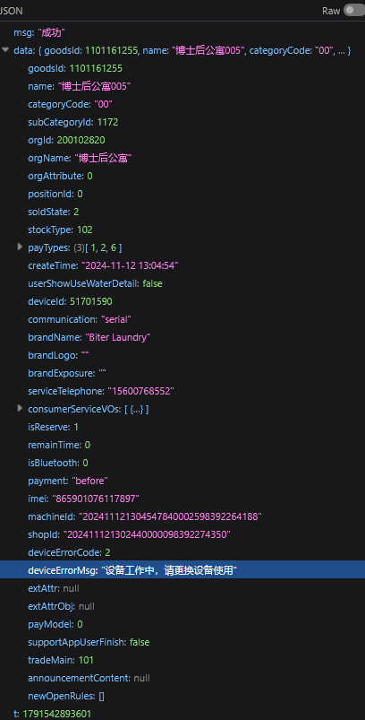
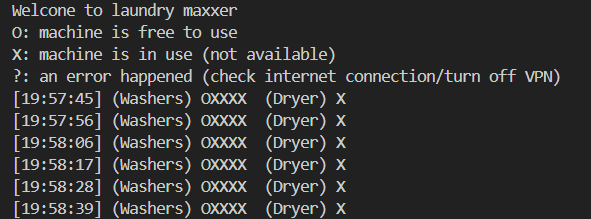

# Laundry maxxing
Some funny project I did when I was bored

## The problem
Our dormitory building has 5 washing machines and a dryer. These machines are accessed through QR codes, like yk those kinds you have to pay and stuff to use.

Now, it's third year, and more and more people have started to live in our dorm building. And all of us still have to share these 5 washing machines and one dryer. 

It caused this one minor quality of life issue: sometimes, all the laundry machines are just full, so you have to go downstairs and check if there's a free space first. I personally like to go down there with my laundry and then wait until one of the machines is free. But sometimes, the wait time is like, what, 30 something minutes. That's a lot of waiting time. And if you go up and do something productive during that time, there's a chance that you forget about it and someone else takes the washer/dryer. Man. If only there's a way for you to check whether there are any free machines downstairs, without like, actually going downstairs.

## The solution
It suddenly hit me one day, the laundry machines themselves are very digitalised, so there's probably a way to programatically check if they're free or not. And there is!

By extracting the qr URL and tracking their Network stuffs, there's this one endpoint `POST https://userapi.qiekj.com/goods/normal/details` that gives you details about the washing machine given their `goods_id`, in which there's this field called deviceErrorMsg, which would be "设备工作中，请更换设备使用" if the machine is being used and null if it's not.

With that, we can simply send a request, check if the response has "设备工作中，请更换设备使用" anywhere in it, and we're done

